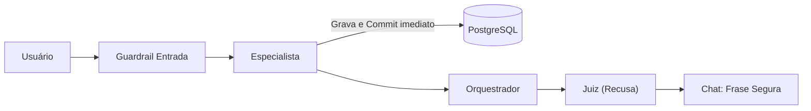
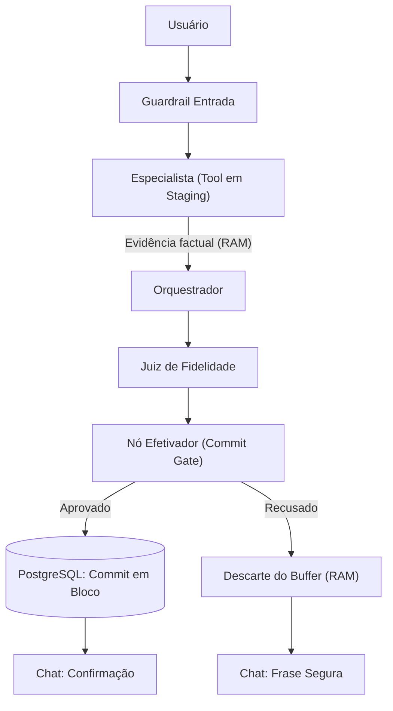

# Decisão Técnica — Etapa 8: O Juiz e a Escrita

**Projeto:** Assessor Pessoal com Inteligência Artificial  
**Mecanismo Escolhido:** Família: Adiar (*Turn Staging Buffer* / Ação em Duas Fases)  
**Repositório:** `juiz_tardio`

---

## 1. A decisão tomada, e por quê

Na Etapa 7, as ferramentas de escrita (`add_transaction`, `update_transaction` e `add_event`) executavam o SQL e comitavam no PostgreSQL imediatamente durante o passo do especialista. Quando o Juiz recusava a resposta final por alucinação, o chat exibia a frase segura, mas a alteração já estava confirmada no banco de dados.

A decisão tomada foi adotar a **Estratégia de Adiar (*Turn Staging Buffer*)**. A fronteira que autoriza a escrita foi transferida da chamada da ferramenta para o nó `efetivador`, posicionado como um *Commit Gate* imediatamente após o nó `juiz` e antes de `END`.

Essa solução cabe no LangGraph porque divide o ciclo da ferramenta em duas etapas integradas ao estado compartilhado:
1. **Fase de Staging:** A ferramenta valida a operação, monta a instrução em memória, enfileira o comando no buffer do turno e retorna um payload factual estruturado. O especialista, o orquestrador e o juiz recebem a evidência necessária sem que nenhuma linha seja gravada no banco.
2. **Fase de Efetivação:** O nó `efetivador` inspeciona o veredito do Juiz. Se aprovado (`juiz:apoiada`), comita todas as operações no banco em bloco atômico único. Se recusado, descarta o buffer da memória sem tocar no PostgreSQL.

Essa fronteira garante que turnos recusados resultem em zero inserções em `add_transaction` e zero registros em `add_event`, enquanto turnos aprovados gravam exatamente uma única vez. Em `update_transaction`, a validação ocorre apenas por leitura (`SELECT`); na recusa, nenhum comando de atualização é executado, mantendo os dados originais intactos. A abordagem também elimina leituras sujas (*dirty reads*), impedindo que consultas concorrentes enxerguem dados não homologados.

### Fluxo Anterior (Commit Prematuro)

### Fluxo Novo (Estratégia de Adiar)

---

## 2. As decisões que o grupo não tomou, e por quê

**Transacionar (*Unit of Work / Transação Longa*):** A ferramenta abriria uma transação no PostgreSQL (`BEGIN`) e manteria a conexão aberta no estado da aplicação enquanto o orquestrador e o juiz processavam, comitando ou fazendo rollback no final. A vantagem seria o isolamento ACID nativo do banco. O custo seria reter conexões abertas por 4 a 7 segundos durante chamadas externas de LLM. Ficou de fora pelo risco de esgotamento do pool de conexões (*connection pool exhaustion*), que derrubaria a disponibilidade do sistema sob concorrência.

**Compensar (*Padrão Saga / Ação Compensatória*):** A ferramenta comitaria imediatamente no banco e guardaria uma ação compensatória (como um `DELETE`). Em caso de recusa, um nó pós-juiz desfaria a escrita. A vantagem seriam conexões ultracurtas (~10 ms). Os custos seriam uma janela de 3 a 5 segundos de leitura suja (*dirty reads*), além de tráfego dobrado de I/O. Ficou de fora pelo risco de falha do compensador (*compensator failure leak*): se o processo cair após a recusa do juiz e antes da compensação, o dado inválido nunca é desfeito e vaza permanentemente no banco.

**Interceptar (*Pre-Execution Gate*):** Um modelo ou guardrail prévio validaria a entrada antes de autorizar o especialista a chamar a ferramenta. A vantagem seria evitar chamadas desnecessárias no banco para entradas inválidas. Os custos seriam de 1,5 a 2,5 segundos extras de latência e cerca de 1.000 tokens a mais por turno. Ficou de fora porque não protege contra alucinações tardias: se a entrada for válida, a ferramenta comita no banco; caso o orquestrador distorça os valores na resposta final, o juiz de saída recusa a mensagem, mas a escrita já terá ocorrido.

---

## 3. O efeito nas métricas do SRE, e como

No monitor de observabilidade da Etapa 6 (`/monitor`), as métricas de confiabilidade e desempenho refletem diretamente os mecanismos de cada abordagem:

**Latência do Turno e p95 (SLO de 8 s):**
Nos testes comparativos reais, os turnos em regime registraram média de 6.900 ms a 7.500 ms. Na decisão tomada de **Adiar**, o p95 permanece preservado dentro do SLO de 8 segundos, pois o nó efetivador pós-juiz adiciona apenas ~3 a 8 ms de I/O local para o commit em bloco (e economiza ~20 ms em recusas ao poupar a escrita no banco). Em contrapartida, na decisão rejeitada de **Transacionar**, manter **uma conexão aberta à espera do veredito** por 7 a 8 segundos forçaria requisições concorrentes a entrarem em fila no pool de conexões, fazendo a cauda p95 estourar com folga o limite de 8 s. Na família de **Interceptar**, o mecanismo de **uma chamada a mais** de modelo de linguagem antes da tool adicionaria de 1,5 a 2,5 segundos fixos no caminho crítico, empurrando a latência diretamente para a faixa de 9 a 10 segundos.

**Taxa de Erro (SLO de 5%) e Classificação de Status (`ok`, `erro`, `bloqueado`):**
O monitor classifica cada turno em três estados estritos:
- `ok`: Requisições finalizadas com sucesso e **um turno que termina em frase segura sem exceção**. Quando o Juiz recusa a resposta, o descarte do buffer de staging em memória RAM é uma operação de dicionário limpa (`dict.pop()`) que não levanta exceção no FastAPI. A taxa de erro do SRE permanece em 0% adicional (dentro do SLO de 5%), pois a recusa por ausência de evidência é uma decisão de negócio legítima do Juiz e não uma falha de software.
- `bloqueado`: Atribuído quando o guardrail de entrada intercepta comandos fora de política ou maliciosos. Conforme definido pelo SLO, o **bloqueio do guardrail de entrada não conta como erro**.
- `erro`: Contabilizado exclusivamente quando ocorre uma exceção técnica no sistema. Na decisão de **Transacionar**, o esgotamento do pool (`max_connections`) dispara exceções `OperationalError`. Como exceções contam diretamente para o SRE, a taxa de erro ultrapassa os 5% do SLO, degradando a disponibilidade do serviço. Já na família de **Compensar**, a necessidade de **um segundo efeito** corretivo (executar um `DELETE` compensatório após a recusa) gera risco adicional de falha de I/O em conexões instáveis, o que também elevaria a taxa de exceções.

**Tokens e Custo por Requisição:**
Na decisão de **Adiar**, a variação de tokens e custos financeiros é estritamente zero, pois o staging em memória não adiciona chamadas de rede nem expande o contexto dos prompts. Em contrapartida, na decisão de **Interceptar**, o mecanismo de **uma chamada a mais** na entrada consome cerca de 800 a 1.200 tokens adicionais por turno, elevando os custos operacionais em mais de 30%.

---

## 4. As outras decisões

**Escopo periférico:** `add_google_event` entrou no escopo do staging via callback porque produz efeito colateral externo no Google Calendar, impedindo que eventos sejam criados na nuvem do usuário caso o turno seja recusado. Já `salvar_mensagem` ficou de fora do staging e foi mantida como estava, pois é executada após o término do grafo e grava no MongoDB a resposta final entregue ao usuário (incluindo a frase segura em recusas), preservando a fidelidade da auditoria da conversa.

**Juiz sem resposta:** Adotada política de *Fail-Safe*. Em caso de timeout, falha de rede ou falta de chave de API, o nó `juiz` retorna a frase segura e anota status de erro. Como o nó `efetivador` exige aprovação explícita para autorizar o commit, qualquer falha aciona o descarte sumário do buffer em memória, garantindo zero escritas no banco.

**Queda de processo:** Se o processo cair antes do nó efetivador, o buffer em memória RAM é liberado e nada atinge o banco. Se a queda ocorrer durante a execução do efetivador, o PostgreSQL executa o *rollback* automático da transação não concluída. O fluxo também utiliza um bloco `finally` para purgar a memória mesmo diante de exceções não tratadas.

**Repetição do mesmo pedido:** Repetir um pedido recusado cria um novo turno, aciona nova recusa do juiz e resulta em novo descarte (zero escritas em ambas). Repetir um pedido legítimo gera turnos independentes e grava dois registros legítimos, respeitando a intenção do usuário.

**Evidência com marcadores únicos:** Em `add_transaction`, a recusa com o marcador `ETAPA8_ADIAR_TEST_01_a9f2bc` ("45 dólares") resultou em 0 linhas gravadas no PostgreSQL, enquanto a aprovação com `ETAPA8_ADIAR_TEST_02_e34a11` ("R$ 25,50") resultou em exatamente 1 linha gravada. Em `update_transaction`, a tentativa de alteração indevida sob `ETAPA8_ADIAR_TEST_03_7b819d` foi recusada e o valor original de R$ 30,00 permaneceu intacto. Em `add_event`, o compromisso fictício sob `ETAPA8_ADIAR_TEST_04_31c890` foi recusado e gerou 0 registros na tabela `events`.

---

## 5. Arquivos criados e arquivos modificados

### Arquivos Criados
- `app/tools/staging.py`
- `decisao_tecnica.md`

### Arquivos Modificados
- `app/tools/financeiro.py`: Refatoração de `add_transaction` e `update_transaction` para enfileirar as operações no staging buffer em memória e retornar evidência factual em vez de executar `commit()` imediato no banco.
- `app/tools/agenda.py`: Refatoração de `add_event` para enfileirar a inserção do compromisso no staging buffer em vez de persistir diretamente no PostgreSQL.
- `app/tools/calendario_google.py`: Adaptação de `add_google_event` para reter o callback de criação do evento no staging buffer, disparando a requisição HTTP somente após aprovação do Juiz.
- `app/graph.py`: Adição do nó `efetivador` como *Commit Gate* pós-juiz, gestão do ciclo de vida do buffer no turno e repasse das evidências internas de ferramentas para a coleta do juiz.
