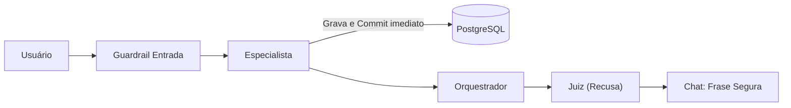
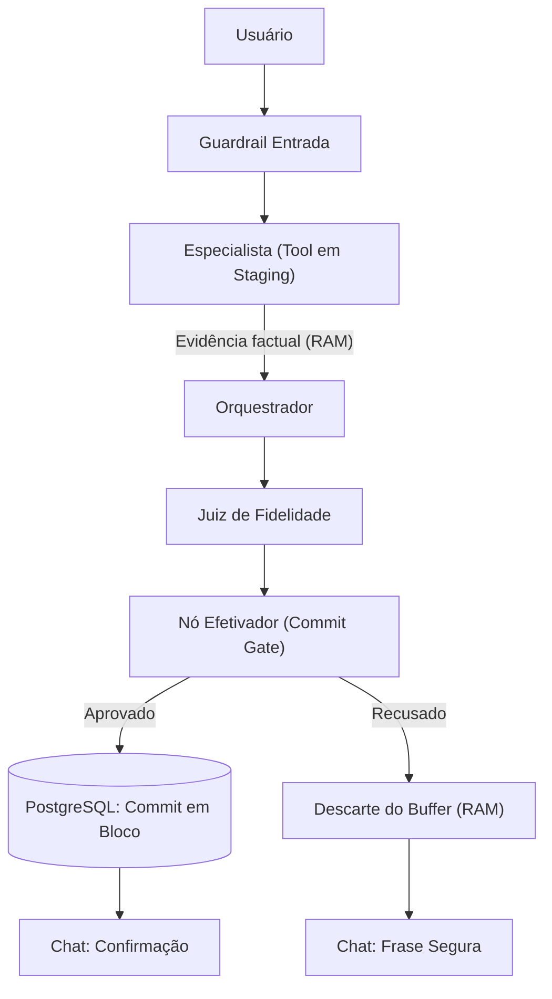

# Decisão Técnica — Etapa 8: O Juiz e a Escrita

**Projeto:** Assessor Pessoal com Inteligência Artificial  
**Mecanismo Escolhido:** Família: Adiar (*Turn Staging Buffer* / Ação em Duas Fases)  
**Repositório:** `juiz_tardio`

---

## 1. A decisão tomada, e por quê

Durante a Etapa 7 nas aulas de IA, as tools `add_transaction`, `update_transaction` e `add_event` executavam o SQL e commitavam no PostgreSQL imediatamente durante o passo do especialista. Então, mesmo quando o juiz recusava a resposta final por falta de evidência ou alucinação, o chat mandava a mensagem segura (*"Não tenho evidência para afirmar isso."*), mas o dado já tinha sido gravado e salvo no banco. O chat dizia não, mas o banco dizia sim.

Por isso, eu e o Cayres escolhemos a **Estratégia de Adiar (*Turn Staging Buffer*)**. A fronteira que autoriza a escrita deixou de ser a chamada da tool no especialista e passou a ser o novo nó **`efetivador`**, colocado no grafo logo após o nó `juiz` e antes de finalizar o turno (`END`).

Essa solução cabe com facilidade no LangGraph porque divide o fluxo em duas etapas:
1. **Fase de Staging:** A ferramenta valida os dados com leituras pontuais (`SELECT`), monta o SQL na memória do turno e devolve um retorno estruturado de sucesso. O especialista, o orquestrador e o juiz recebem a evidência factual necessária para tomar decisões, mas nada é gravado no banco de dados ainda.
2. **Fase de Efetivação:** O nó `efetivador` olha a decisão do juiz. Se o juiz aprovar (`juiz:apoiada`), o nó pega todas as operações acumuladas na fila e comita tudo no banco de uma vez só, em uma transação atômica. Se o juiz recusar, o nó simplesmente descarta a fila da memória RAM, sem mandar nenhum comando pro banco.

Essa fronteira garante que:
- Em `add_transaction`: se o turno for recusado, nenhum `INSERT` vai pro banco (zero linhas gravadas). Se aprovado, grava exatamente uma vez.
- Em `update_transaction`: a ferramenta só faz uma consulta para checar a transação. Se for recusado, nenhum `UPDATE` é executado e o valor original continua intacto. Se aprovado, atualiza uma única vez.
- Em `add_event`: se for recusado, nenhum compromisso entra na tabela `events`. Se aprovado, grava uma vez só.
- Evita leituras sujas (*dirty reads*), porque nenhuma informação duvidosa chega a entrar nas tabelas enquanto os modelos ainda estão pensando.

### Fluxo Anterior (Commit Prematuro)

### Fluxo Novo (Estratégia de Adiar)

---

## 2. As decisões que o grupo não tomou, e por quê

A gente avaliou as outras três famílias de solução e preferiu deixar de fora pelos seguintes motivos:

### Manter uma transação aberta (Transacionar)

Nessa opção, a ferramenta faria a alteração dentro de uma transação do PostgreSQL (`BEGIN`), mas deixaria a conexão aberta no estado da aplicação para confirmar (`commit`) ou desfazer (`rollback`) só depois da decisão do juiz.

A vantagem é usar o mecanismo de transações ACID do próprio banco sem ter que gerenciar lista na memória. O custo real é manter a conexão física e o socket do banco ocupados por 4 a 7 segundos enquanto o orquestrador e o juiz chamam APIs externas de LLM. Ficou de fora porque essa espera esgota o limite de conexões do PostgreSQL (*connection pool exhaustion*), travando o sistema se vários usuários mandarem mensagem ao mesmo tempo e gerando erro de conexão no banco.

### Gravar e depois compensar (Compensar)

Aqui, o sistema gravaria e commitava a alteração imediatamente (como era na Etapa 7) e guardaria uma ação inversa no estado do turno. Se o juiz recusasse, um nó compensador tentaria desfazer, executando um `DELETE` ou restaurando os valores antigos.

A vantagem é ter conexões bem rápidas com o banco (~10 ms). O custo é que o dado incorreto fica visível no banco por 3 a 5 segundos durante a análise do juiz, podendo ser lido por consultas de saldo ou relatórios paralelos (*dirty reads*), além de dobrar o tráfego de gravação. Ficou de fora pelo risco de falha do compensador (*compensator failure leak*): se o servidor cair ou a conexão falhar logo após a recusa e antes da compensação rodar, o dado errado nunca é desfeito e fica gravado para sempre no banco.

### Interceptar o pedido antes da ferramenta (Interceptar)

Essa opção colocaria um modelo ou guardrail prévio para analisar o pedido do usuário antes de permitir que o especialista chamasse a ferramenta de escrita, barrando valores e moedas suspeitas logo na entrada.

A vantagem é bloquear pedidos inválidos antes de gastar chamadas no banco. Os custos reais são somar de 1,5 a 2,5 segundos de latência e gastar cerca de 1.000 tokens a mais por mensagem. Ficou de fora porque não resolve alucinações tardias: se o usuário fizer um pedido válido, a ferramenta grava e commita no banco; se depois disso o orquestrador distorcer os dados ou inventar valores na resposta final, o juiz de saída vai recusar a fala, mas a alteração já vai ter acontecido no banco.

---

## 3. O efeito nas métricas do SRE, e como

Nos testes que a gente rodou comparando o projeto anterior com o atual, o impacto no monitor da Etapa 6 (`/monitor`) ficou bem claro:

**Latência do Turno e p95 (SLO de 8 s):**  
Nos testes reais, os turnos ficaram com média entre 6.900 ms e 7.500 ms. Na decisão de **Adiar**, o p95 continua seguro abaixo dos 8 segundos, pois efetivar o commit em bloco pós-juiz adiciona apenas 3 a 8 ms locais quando aprovado (e economiza uns 20 ms em recusas, já que nem acessa o banco). Já se tivéssemos escolhido **Transacionar**, segurar **uma conexão aberta à espera do veredito** por 7 a 8 segundos faria requisições concorrentes disputarem vagas no pool, empurrando o p95 para além dos 8 segundos. Na de **Interceptar**, o mecanismo de **uma chamada a mais** de LLM na entrada somaria de 1,5 a 2,5 segundos fixos a cada turno, estourando a meta de latência.

**Taxa de Erro (SLO de 5%) e Status (`ok`, `erro`, `bloqueado`):**  
O monitor classifica as requisições em três status:
- `ok`: Usado para turnos bem-sucedidos e para **um turno que termina em frase segura sem exceção**. Quando o juiz recusa, o nó efetivador apenas descarta o buffer da memória RAM com um `dict.pop()`. Isso não dispara nenhuma exceção no FastAPI, então a taxa de erro continua em 0% adicional (dentro do SLO de 5%), já que a recusa é uma resposta de negócio esperada do juiz e não uma falha do sistema.
- `bloqueado`: Quando o guardrail de entrada barra mensagens fora da política. Conforme a regra do SLO, o **bloqueio do guardrail de entrada não conta como erro**.
- `erro`: Só conta quando ocorre uma exceção não tratada. Se a gente tivesse escolhido **Transacionar**, o esgotamento do pool geraria exceções `OperationalError`, que contam como erro e fariam a taxa passar dos 5% do SLO. Na opção de **Compensar**, a necessidade de disparar **um segundo efeito** no banco para deletar a linha após a recusa também traria risco de exceção caso a rede oscilasse.

**Tokens e Custo por Turno:**  
No nosso método de **Adiar**, o consumo de tokens e o custo em dólares continuam exatamente os mesmos do projeto original (variação zero), pois o staging roda só em memória e não adiciona nenhuma chamada de modelo nem amplia prompts. Já na opção de **Interceptar**, ter **uma chamada a mais** de modelo gastaria cerca de 800 a 1.200 tokens extras por mensagem, aumentando o custo operacional em mais de 30%.

---

## 4. As outras decisões

**Escopo periférico (`add_google_event` e `salvar_mensagem`):**  
A ferramenta `add_google_event` entrou no escopo do staging porque mexe diretamente no Google Calendar do usuário. Se o juiz recusar um compromisso, o evento não pode aparecer na agenda da pessoa; por isso, a ferramenta guarda um callback na memória e só dispara a chamada da API do Google se o juiz aprovar o turno. Já a função `salvar_mensagem` ficou de fora do staging e continuou como estava, pois ela roda depois que o grafo inteiro finalizou, salvando no MongoDB o histórico do que o usuário realmente viu (incluindo a frase segura de recusa), o que garante uma auditoria correta da conversa.

**Juiz sem resposta (Fail-Safe):**  
Se a API do juiz sofrer timeout, der erro de rede ou faltar a chave de API, o nó `juiz` captura a falha e devolve a frase segura com rótulo de erro. Como o nó `efetivador` exige aprovação explícita para autorizar o commit, qualquer falha ou ausência de veredito faz o buffer ser descartado da memória. Na dúvida, nada é gravado no banco.

**Queda do processo entre passos:**  
Se o servidor cair enquanto o especialista ou o orquestrador estão pensando, o buffer de staging existe apenas na memória RAM volátil e se apaga sozinho com a interrupção, deixando o PostgreSQL e o Google Calendar 100% intactos. Se a queda acontecer durante o nó efetivador, o commit é feito em bloco; se a conexão cair antes do final, o próprio banco executa o *rollback* automático. Além disso, o fluxo usa uma cláusula `finally` que limpa o buffer do turno mesmo se acontecer alguma exceção no meio do caminho.

**Repetição do mesmo pedido:**  
Se o usuário repetir um pedido que foi recusado (ex: *"gastei 50 dólares no almoço"*), abre-se um novo turno com novo ID, o juiz recusa de novo e o buffer é descartado novamente (zero gravações em ambas as vezes). Se repetir um pedido legítimo aprovado (ex: *"almoço R$ 25"*), cada mensagem tem seu próprio turno e grava dois lançamentos separados, respeitando a intenção do usuário caso ele realmente queira cadastrar duas despesas iguais.

**Evidência com marcadores únicos nas três tools:**  
Comprovamos a garantia na prática com os testes reais no PostgreSQL:
- Em `add_transaction`: a tentativa em dólares com o marcador `ETAPA8_ADIAR_TEST_01_a9f2bc` foi recusada pelo juiz e resultou em 0 linhas gravadas no PostgreSQL, enquanto a despesa em reais sob o marcador `ETAPA8_ADIAR_TEST_02_e34a11` foi aprovada e gerou exatamente 1 linha no banco.
- Em `update_transaction`: a tentativa de alterar o valor para 999 reais sob o marcador `ETAPA8_ADIAR_TEST_03_7b819d` foi recusada e o registro original manteve seus R$ 30,00 e descrição intactos.
- Em `add_event`: a tentativa de agendamento sem dados claros sob o marcador `ETAPA8_ADIAR_TEST_04_31c890` foi recusada e gerou 0 registros na tabela `events`.

---

## 5. Arquivos criados e arquivos modificados

### Arquivos Criados
- `app/tools/staging.py`
- `decisao_tecnica.md`

### Arquivos Modificados
- `app/tools/financeiro.py`: Refatoração de `add_transaction` e `update_transaction` para preparar as operações no staging buffer em vez de comitar imediatamente no banco.
- `app/tools/agenda.py`: Refatoração de `add_event` para colocar a inserção do compromisso no staging em vez de gravar direto no PostgreSQL.
- `app/tools/calendario_google.py`: Adaptação de `add_google_event` para guardar o callback de criação do evento no staging, chamando a API do Google Calendar só depois da aprovação do juiz.
- `app/graph.py`: Adição do nó `efetivador` pós-juiz para comitar ou descartar o buffer, e repasse das evidências internas das tools (`evidencias_juiz`) para a coleta do juiz.
