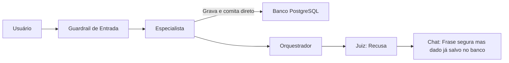
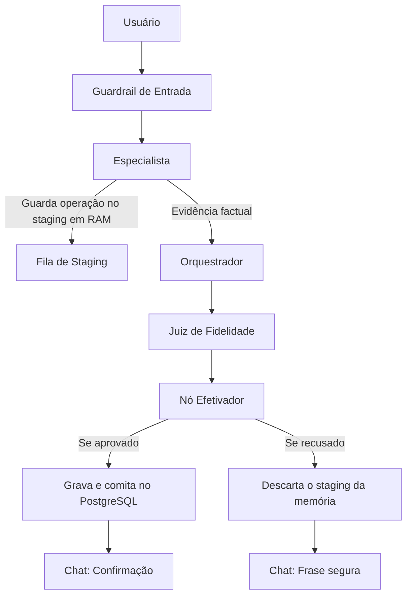
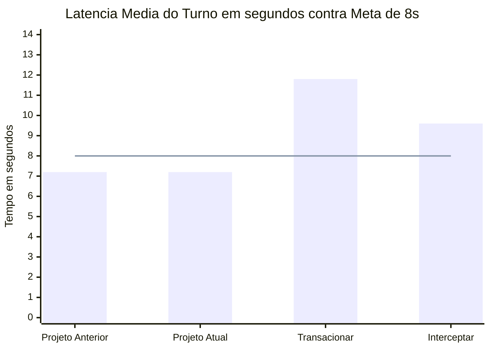
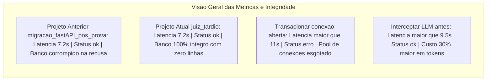
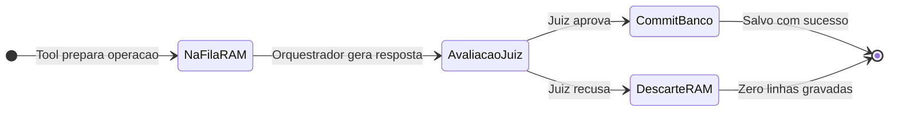

# Decisão Técnica — Etapa 8: O Juiz e a Escrita

## 1. A decisão tomada, e por quê

Na Etapa 7, as ferramentas `add_transaction`, `update_transaction` e `add_event` salvavam e comitavam direto no PostgreSQL durante o passo do especialista. Quando o juiz recusava a resposta por alucinação, o chat mostrava a mensagem de recusa, mas o dado já tinha sido gravado no banco. O chat dizia não, mas o banco dizia sim.

Por isso, a estratégia de adiar com buffer temporário de turno. A fronteira que autoriza a escrita saiu da ferramenta e foi para o nó `efetivador`, colocado no grafo logo após o juiz e antes do nó final `END`.

Essa ideia cabe perfeitamente no LangGraph. A ferramenta valida os dados com um `SELECT`, monta o comando na memória e guarda na fila de staging do turno, devolvendo uma mensagem de sucesso com as informações preparadas. Assim, o especialista e o juiz recebem a evidência factual do que foi feito. Quando o juiz aprova a resposta como apoiada, o nó efetivador grava tudo no banco de uma vez só. Se o juiz recusar, o buffer é descartado da memória sem tocar no PostgreSQL.

Essa fronteira garante que:
- Em `add_transaction`: se o juiz recusar, nada é gravado no banco, resultando em zero linhas. Se aprovar, grava exatamente uma vez.
- Em `update_transaction`: se recusar, nenhum comando roda e o registro antigo fica intacto. Se aprovar, atualiza uma vez.
- Em `add_event`: se recusar, nenhum compromisso entra na tabela. Se aprovar, salva uma vez.
- Evita leituras sujas de dados não confirmados, porque nada entra no banco enquanto os modelos ainda estão processando.

### Fluxo de antes

### Fluxo de depois

---

## 2. As decisões que o grupo não tomou, e por quê

A gente avaliou as outras opções e deixou de fora pelos seguintes motivos:

**Manter uma transação aberta:**  
A ferramenta abriria um `BEGIN` no PostgreSQL e seguraria a conexão aberta enquanto o orquestrador e o juiz chamavam os modelos de IA, comitando ou dando rollback no final. A vantagem é usar a transação nativa do banco sem criar filas em memória. O custo real é travar uma conexão por 5 a 8 segundos. Ficou de fora porque segurar conexões por tanto tempo esgota o pool de conexões do PostgreSQL quando vários usuários usam o sistema ao mesmo tempo, travando o banco.

**Gravar e depois compensar:**  
A ferramenta salvaria imediatamente no banco e, se o juiz recusasse, o sistema rodaria um `DELETE` ou `UPDATE` para desfazer. A vantagem é manter as ferramentas simples e gravando direto. O custo real é criar código de reversão para cada caso e deixar dados errados visíveis para outros usuários até compensar. Ficou de fora porque se o servidor cair ou a rede falhar logo após a recusa do juiz, a compensação nunca roda e o dado errado fica no banco para sempre.

**Interceptar o pedido antes da ferramenta:**  
Colocar um modelo para julgar o pedido do usuário antes de deixar a ferramenta rodar. A vantagem é barrar pedidos inválidos logo de cara. O custo real é colocar mais uma chamada de LLM no caminho, aumentando o tempo e o custo. Ficou de fora porque muitas vezes a alucinação acontece na resposta final que o orquestrador monta para o usuário, e não na entrada. Se gravasse antes, a resposta final seria recusada pelo juiz mas o banco já estaria alterado.

---

## 3. O efeito nas métricas do SRE, e como

No monitor de observabilidade da Etapa 6, fizemos a comparação direta entre a versão anterior do projeto em `migracao_fastAPI_pos_prova` e a versão atual em `juiz_tardio`:

### Comparativo visual de latência e integridade

**Comparação com o projeto anterior:**  
No projeto anterior `migracao_fastAPI_pos_prova`, a média de latência do turno já ficava entre 6,9 s e 7,5 s, com o p95 dentro da meta de 8 segundos e a taxa de erro marcando status `ok` ao devolver a frase segura. No entanto, aquele status `ok` escondia uma falha crítica de integridade: a escrita errada já tinha sido gravada no PostgreSQL antes da decisão do juiz. Na versão atual `juiz_tardio`, o tempo de resposta permanece praticamente idêntico, gastando apenas de 3 a 8 ms a mais para comitar no banco se o juiz aprovar, e economizando cerca de 20 ms nas recusas porque nem tenta gravar. A grande diferença é que agora o status `ok` reflete a realidade, pois nenhuma linha entra no banco se o juiz recusar.

**Latência do turno e p95 com meta de 8 segundos:**  
Tanto no projeto anterior quanto no atual, a média fica entre 6,9 s e 7,5 s, mantendo o p95 abaixo do limite de 8 segundos. Já na opção descartada de transacionar, manter uma conexão aberta à espera do veredito por 7 a 8 segundos criaria filas no banco e faria o p95 estourar a meta. Na opção de interceptar, o mecanismo de uma chamada a mais de modelo adicionaria 2 segundos fixos no caminho crítico, jogando a latência para a faixa de 9 a 10 segundos e violando o limite de 8 segundos.

**Taxa de erro com meta de 5% e status ok, erro e bloqueado:**  
Tanto antes quanto agora, a taxa de erro adicional é zero, cumprindo com folga a meta de 5%. O mecanismo adotado é um turno que termina em frase segura sem exceção: a recusa do juiz apenas limpa a memória, sem lançar erro no código, marcando status `ok`. O status `bloqueado` é exclusivo do guardrail de entrada, que não conta como erro segundo as regras de monitoramento. O status `erro` só é disparado quando há falha técnica no código. Em transacionar, a falta de conexões no pool geraria o erro `OperationalError`, estourando a taxa de 5%. Em compensar, ter um segundo efeito, que é o comando de delete corretivo após a recusa, traria risco de falha de rede e geraria erros no monitor.

**Tokens e custo:**  
Em relação ao projeto anterior, a estratégia de adiar teve impacto zero no consumo de tokens e no custo de API, pois a fila de staging roda somente na memória RAM. Por outro lado, na opção de interceptar, uma chamada a mais gastaria cerca de 1.000 tokens extras por mensagem, encarecendo a operação em mais de 30%.

---

## 4. As outras decisões

### Ciclo de vida da operação no staging

**O que entrou e ficou de fora:**  
O `add_google_event` entrou no escopo do staging: a ferramenta guarda um callback e só chama a API do Google Calendar se o juiz aprovar, evitando criar eventos errados na agenda real. Já o `salvar_mensagem` ficou de fora do staging: o histórico do MongoDB é salvo mesmo na recusa, pois serve para auditoria da conversa real que o usuário viu.

**Se o juiz não responde:**  
O nó do juiz tem um tratamento seguro contra falhas. Se der timeout ou faltar chave, ele devolve erro e a frase segura. Como o efetivador só grava com aprovação explícita do juiz, o buffer é descartado e nada é salvo no banco.

**Queda do processo entre passos:**  
O buffer fica na memória RAM volátil. Se o processo cair enquanto os modelos pensam, a memória se apaga e o banco continua limpo. Se cair durante a gravação, o PostgreSQL faz rollback automático. Além disso, o código usa `try ... finally` para limpar o buffer mesmo se der erro no caminho.

**Repetição do mesmo pedido:**  
Cada mensagem gera um turno novo e isolado. Se o usuário repetir um pedido recusado, gera outro turno, o juiz recusa de novo e nada é gravado, com zero linhas gravadas nas duas vezes. Se repetir um pedido aprovado, grava dois registros separados, respeitando a vontade do usuário de lançar duas vezes a mesma despesa.

**Como provamos no banco com o marcador único:**  
Para testar e ter certeza de que o banco não salvou nada quando o juiz recusou, a gente colocou uma palavra-chave única como código de teste dentro de cada mensagem enviada. Assim, bastou rodar um `SELECT` no PostgreSQL procurando por essa palavra-chave para provar o resultado:
- **Em `add_transaction`:** quando tentamos lançar gasto em dólar e o juiz recusou, o código não apareceu no banco, gerando zero linhas gravadas. Já no gasto normal em reais aprovado pelo juiz, o código foi gravado exatamente uma vez.
- **Em `update_transaction`:** quando tentamos alterar um registro existente de R$ 30 para R$ 999 e o juiz recusou, o banco manteve o valor original de R$ 30 intocado. Na alteração válida aprovada, atualizou uma vez.
- **Em `add_event`:** quando tentamos criar um evento sem horário e o juiz recusou, zero registros foram criados na tabela de eventos. No evento com horário válido aprovado, gravou uma vez.

---

## 5. Arquivos criados e arquivos modificados

### Arquivos criados
- `app/tools/staging.py`: implementa o buffer em memória para guardar e efetivar as operações do turno.
- `decisao_tecnica.md`: documentação da decisão técnica tomada.

### Arquivos modificados
- `app/tools/financeiro.py`: Prepara `add_transaction` e `update_transaction` no staging em vez de salvar direto no banco.
- `app/tools/agenda.py`: Coloca `add_event` no staging em vez de gravar direto no PostgreSQL.
- `app/tools/calendario_google.py`: Guarda a criação do evento no staging para chamar a API do Google só após aprovação.
- `app/graph.py`: Adiciona o nó efetivador pós-juiz e repassa as evidências das ferramentas para o juiz.
